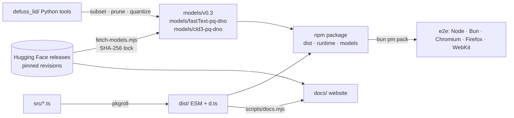

# Architecture: defuss-lid

defuss-lid turns released language-identification models (fastText `lid.176`, Google CLD3) into small language packs and runs them in Node.js, Bun and browsers. The repository holds the TypeScript runtime (`src/`), the Python tools that build and evaluate packs (`defuss_lid/`, `scripts/*.py`), the CLD3 WebAssembly core (`runtime/`), the project site (`docs/`) and the measured reports (`documentation/`, `reports/`). It does not train models, host an inference service or ship the model files in git: they are released on Hugging Face and pinned by hash.

## Why this design

**Reuse released weights instead of training.** Training a language identifier needs large labeled corpora and evaluation infrastructure; the released fastText and CLD3 coefficients are already well studied. Packs remove outputs, prune input features that a calibration corpus never used, and quantize, so every accuracy change is attributable to one compression step and measured against an exact-subset baseline (`documentation/results-v0.3.md`). The two CLD3 packs go one step further (DNO-PQ): their quantized embeddings stay as they are, and only the hidden and softmax layers are refitted on held-out text, starting from Google's weights. Refitting two small layers instead of training a network keeps CLD3's feature extraction and embedding knowledge and changes only how the evidence is weighed. VERIFIED: on the benchmark, which the refit never read, `major_20` and `full` with the default letter boost make 15% to 82% fewer errors than Google's original weights (`documentation/results-dno-pq.md`, 2026-11-03).

**A TypeScript fastText runtime, a WebAssembly CLD3 runtime.** fastText inference is a hash, a table lookup and a few hundred multiply-adds per word, so a port is ~17 kB of JavaScript, starts synchronously and runs in every engine; it matches native fastText within 3e-5 (`tests/native-fixtures.json`). CLD3's feature extraction is intricate C++, so instead of porting it the CLD3 runtime decodes a pack's weights into the original cld3-asm 4.0.0 binary; the raw pack rebuilds the upstream binary byte for byte (`tests/cld3.test.ts`), which proves the pipeline leaves CLD3's behaviour untouched.

**One container format for both families.** A DLID file is a JSON header plus aligned little-endian arrays (`src/container.ts`, `defuss_lid/format.py`): it maps onto typed arrays and NumPy without a parser dependency and carries provenance (source hashes, changes, license) next to the weights.

**Letters as evidence next to the model, not as a filter.** Both models read letters statistically, so a short text can come out in a language whose alphabet it does not use (the v0.3 `major_20` called "гроза" Portuguese, with CLD3's `reliable` flag set). `src/boost.ts` measures the share of a text's letters each language's alphabet explains, from one line of letters per language (`src/charsets.ts`). The `boost`, on by default (`boost: false` turns it off), adds a weight times that share to the model scores (1 for fastText, 20 for CLD3; each tuned on held-out selection text, `src/boost.ts`); a hard script filter instead would throw away the right answer whenever a text mixes scripts (Latin names in Japanese or Russian text), while the additive boost lets the model still decide. VERIFIED: weight 1 improved or kept the accuracy of all four packs on every benchmark slice, and CLD3's weight 20 then improved or kept every benchmark slice of the four CLD3 files measured against weight 1 (2026-11-03); at weight 1 and against the 0.3.0 build, the `reliable` check raised the precision of `major_20`'s reliable answers on FLORES-200 dev 8-code-point prefixes from 79.8% to 85.4% and cut reliable answers for languages outside the pack from 72.6% to 37.0% (2026-11-02; accuracy: `scripts/boost_eval.mjs` and README).

**Models from pinned releases, not from git.** `models.lock.json` names three Hugging Face releases, the v0.3 release (kyr0/defuss-lid-1.0), the fastText DNO-PQ packs (kyr0/fastText-pq-dno) and the CLD3 DNO-PQ packs (kyr0/cld3-pq-dno), each with its revision, and the SHA-256 of all 36 files; `scripts/fetch-models.mjs` downloads and verifies them, and `prepack` refuses to pack without them. A changed upstream file therefore fails setup instead of silently changing results.

## How it works

- `src/container.ts` parses and validates DLID containers; `src/index.ts` is the fastText runtime (`LidModel`, `loadModel`); `src/cld3-pack.ts` rebuilds and instantiates CLD3 from a pack and `runtime/cld3-core.bin.gz` after checking both hashes; `src/cld3.ts` wraps the unmodified npm build as the reference provider.
- `src/boost.ts` is the letter evidence (`letterSupport`, the `boost` option of both runtimes, the `reliable` check of CLD3) over the table in `src/charsets.ts`; the runtimes share it as one chunk, so the table ships once.
- `src/packs/index.ts` is the registry (names, languages, bytes, SHA-256). Each pack has a `.node.ts` loader (reads from disk, `node` export condition) and a `.browser.ts` loader (fetch). Both use a literal `new URL('../../models/…', import.meta.url)`, so bundlers emit the asset and the path stays valid from `dist/packs/`.
- The Python package mirrors the fastText runtime for reference inference and implements export, subsetting, feature pruning, PQ fitting and int8 heads; `scripts/reproduce_v03.py` rebuilds the release and its benchmarks.
- Contracts other folders rely on: the DLID layout and header fields, the pinned CLD3 layout in `runtime/cld3-layout.js`, the registry agreeing with `models.lock.json`, and `docs/assets/lib/` being a byte copy of the built runtime. `scripts/verify.mjs` checks the last two and every other duplicated fact.

## Operations

- **Configuration and policy:** no runtime configuration; behaviour is set per call (`k`, `threshold`, `languages`, `cacheSize`, `coreURL`). Gate policy lives in `.vae/VERIFY.py`, tool versions in `mise.toml`, `bun.lock` and `uv.lock`.
- **Deployment and scaling:** the npm package ships `dist/`, `runtime/`, `models/v0.3/`, `models/fastText-pq-dno/` and `models/cld3-pq-dno/`; GitHub Pages serves `docs/` as-is. The runtime is per-process and stateless apart from each model's bounded feature cache.
- **Complexity and resources:** fastText prediction is linear in the number of characters (n-grams) times the embedding dimension, plus one classifier pass; `make bench` measured 7 to 25 µs per fixture sentence on an Apple M-series CPU. CLD3 packs reduce download size only: the full native layout (744,144 bytes of WebAssembly) is rebuilt in memory at load time.
- **Third-party integrations:** Hugging Face (model download at setup, pinned by revision and hash; a weekly CI job checks the remote files), jsDelivr (defuss-shadcn styles for the site, pinned by version and Subresource Integrity). The runtime itself makes no network requests beyond the URLs a caller passes.
- **Reliability:** loaders fail closed: a truncated, tampered or mismatched model or core throws before inference.

## Security and privacy

Model files and the CLD3 core are untrusted input: the container parser bounds-checks every section, the fastText runtime validates shapes, ids, scales and the Huffman tree before use, and the CLD3 core must match two pinned SHA-256 hashes before it is instantiated as WebAssembly. Text is processed in the caller's process and never sent anywhere; the runtime keeps no data beyond the feature cache of a loaded model. No personal data is collected or stored by the library, the site or the build. Benchmark corpora (FLORES-200, MASSIVE) are downloaded only by the reproduction scripts and are not redistributed; reports keep labels, ids and predictions.
